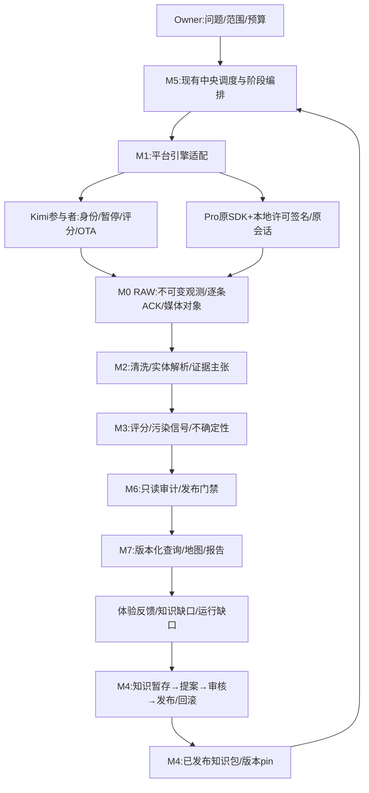

> 1.3校准：本文保历史接口/机制；当前执行顺序以[主计划](PRODUCT-PLAN.md)第9–11节为准，运行事实只看HANDOFF。旧工期不是新的启动要求。

> 本文为E63/12:07设计与静态资产基线。E65/E66随后已接通已ACK素材和六店领域只读交付；不是全部M0–M7完成。最新事实看固定HANDOFF；剩余执行顺序看PRODUCT-PLAN 1.3第10–11节。

# CTFS v2.2 融合架构与实施边界

日期：2026-10-16（Asia/Shanghai）。性质：研究/执行设计，未采用、未部署、未新增采集或模型调用。范围：完整读本目录 `REFERENCE-v2.2-TEXT.txt`（311行、原HTML提取文本SHA `2d8dc4db8ada8ad2cf091b4518b319221555155fce8daaad72712cf763d57912`），并以正式交接E63和本地固定源码/依赖核对。本文不替换原PRD，不把历史源码快照说成当前线上版本。

## 1. 产品是什么，用户如何得到结果

CTFS 是把分散来源转成有出处、可更新、可审核的领域知识和可用产品的数据工具柜。M1分布式采集是其中的数据获取能力；不是整个产品。上海美食是首个消费项目：消费者发现值得尝试的餐厅、理解证据与不确定性、保存想吃/不感兴趣/实际体验，反馈进入知识更新。另一个领域消费相同模块，是通用化的验收，不是先搭通用平台的理由。

产品闭环：Owner定义问题/覆盖范围/预算与交付目的 → 选择已发布知识包 → 中央分发有界任务 → Kimi参与者或Pro机器引擎取得材料并逐条回执 → 清洗并形成实体/证据 → 可解释评分与待复核项 → 审计发布快照 → 查询/地图/报告 → 用户反馈和运行缺口回到M4暂存、审核、知识新版。参与者贡献评分与餐厅质量评分分开，不将机器采集计成人工奖励。

| 角色 | 操作路径 | 不能由后台代替的判断 |
|---|---|---|
| 项目Owner | 新建项目/范围，选源与知识包，预览预算，处理需本人会话确认，审核知识/发布，查异常 | 本人账号选择/新权限、知识采用、对外发布、范围/预算变更 |
| Kimi参与者/终端贡献者 | 保留已有加入、身份、领取、暂停/继续、耐久回传、回执、评分和签名OTA | 是否贡献及账号授权；本机原身份/队列不得因升级重建 |
| 机器执行终端 | 已登记安装与原会话，在有租约的任务内调用Pro成熟引擎；不需要用户逐HTTP分配 | 不能轮换成未选择的账号、借其他profile、重发未知任务 |
| 领域维护者/审核者 | 处理实体冲突、知识提案、污染标签、规则变更与证据缺口，发布新包 | 模型提议不自动成为事实或生效规则 |
| 消费者 | 在交付端检索/筛选/看证据，保存想吃与体验，反馈错误 | 想吃不等于实际吃过；反馈不自动改变公共知识或评分 |

## 2. 先融合边界，不重造平台引擎

采用单个CTFS应用的逻辑模块 M0–M7，以Python包函数和现有CLI串接；同一发布快照约束输入输出。现有中央PostgreSQL/Edge继续负责跨终端任务/租约/逐条回执；本机工作台继续Owner操作和执行器托管。它们是一个工作流的不同边界，不再新增第二个独立任务控制面。

Pro主采集器负责其成熟的平台请求、原模型、分页/回复和存储；本系统仅在已证明不等价的软阈值、耐久保存/游标、错误分类、原会话范围与预算处做小适配。签名算法、平台解析不重新实现。MC成熟媒体下载作为可独立调用的媒体子流程，来源引擎与媒体引擎分别标注。原媒体接口完整可用才开放对应能力；不把 `media=true` 改False逃避验收。

Kimi贡献链不替换成Pro账号池；同一任务合同标明执行模式和证据类型。保留评分、旧ID、outbox、撤销与OTA；Pro机器任务可以共享任务监控/回执，但不能伪造人工页面步骤或奖励。

## 3. 接口与数据权威：从原始证据到交付快照

以下是拟统一的最小接口对象，不是宣称已有全部API。先写版本化JSON和同进程调用；只对现有跨设备边界保留HTTP/RPC。

| 对象 | 最小合同与权威 | 接线原则 |
|---|---|---|
| ProjectManifest | project_id、domain_pack版本/SHA、问题、来源范围、预算、交付/保鲜策略 | 项目配置不是Cookie配置；调用固定版本，不随本体latest漂移 |
| AcquisitionRequest | 原平台/模式/目标、根评论语义/回复/media/options、会话引用、全部HTTP尝试上限、deadline、执行器 | 延续现有task/child/run/lease/epoch；显式Pro不静默fallback；默认MC旧任务哈希不迁移 |
| ObservationEnvelope | 源平台/实体ID、采集与来源时间、原始字节/typed摘要、正文/根/回复、来源位置、run/claim/会话证据等级、覆盖/游标/部分原因 | 当前capture/outbox原UUID/hash/ACK不改；公共来源payload与身份凭据分开；未知不伪completed |
| CanonicalEntity + ClaimEvidence | entity_id、领域类型/字段、原观测引用、字段级来源/核验时间/冲突/状态 | 平台帖子作者≠餐厅实体；Observation可被多个主张引用，不能用“同店”丢原文 |
| ScoreArtifact | 实体/证据集合SHA、rubric版本、维度/贡献项/置信或区间、污染模型版本、人工裁决、未评分原因 | 参与贡献分与领域品质分独立；缺证不默认为0分或中性 |
| KnowledgeSubmission/Proposal/Release | 原来源/权限、用途、结构提案、父版本、reviewer、采用/拒绝、发布hash、项目pin、反馈关联 | 原包字节是发布知识权威，DB为生命周期/权限/索引；未发布提案不可被生产读取 |
| AuditReport / ReleaseSnapshot | 固定输入/全部模块版本、分项pass/fail/unknown、覆盖、真实证据/测试范围、审批/回滚指针 | 测试通过≠部署≠业务通过；不可把unknown折叠为pass |
| DeliveryView | 发布快照、可见字段、实体/证据/评分/保鲜/不确定性、消费者访问范围 | 只读DW/APP发布视图；签名下载URL临时生成，稳定的是对象标识和SHA |

多种哈希域必须分名：原始源字节/平台观测、标准化语义版本、正文、envelope、媒体字节、知识包、发布快照。现有Python短转义JSON与网关canonical域并不相同，不能统一重算旧hash。需要桥接时用经审的投影校验，保留原件。跨attempt复用属于原origin/原ACK，不增新capture；新HTTP同ID另记真实新观测。

通用RAW输出应为ObservationEnvelope，可有 `content/comment/media/entity_candidate` 类型。`raw_place.schema.json`只属于美食/POI领域适配，不能强迫视频、评论、房源、软件知识都扮成餐厅。领域包允许持有真正差异，但平台/地址解析、模型实现也可能需要插件代码；“新增任何需求永远不改内核”“业务词grep零命中”不是合理兼容承诺。

## 4. M0–M7的可执行融合步骤

### M0 存储：保护既有账本，增派生层

**现资产**：本机ResultsStore实体/版本/观测，SQLite outbox和MachineSteps；中央capture/租约/逐条receipt及私有媒体bucket；CTFS工具包已有RAW/clean/scored/audit契约与Storage/Postgres适配快照。E63新业务证明WB有限新评论/原图/ACK；XHS有限证据另按此前原run引用，不是整CTFS仓库已融合。

**接口**：ObservationEnvelope→源账本；CanonicalEntity/ClaimEvidence→ODS；ScoreArtifact→DW；ReleaseSnapshot→APP。先用同一Postgres内逻辑表/视图区分project/domain，租户权限隔离，不以城市前缀代替租户隔离。SQLite继续终端耐久队列，不能从参与者访问中心service_role。

**步骤**：①固定现表/schema/行摘要、媒体对象和backup恢复；②建立最小派生表与原capture引用，不改原数据；③导入一份固定既有样本，逐对象对账；④补字段历史/last_verified/stale；⑤以新发布快照切视图。新表/schema变化必须白名单记录，不再笼统宣称全库schema不变。

**同输入验收**：源记录数/typed字段/hash/父子/媒体字节不丢；重复导入不增语义版本或奖励；重启回读、迟到ACK、冲突、撤销、跨租户拒绝和备份恢复。**采用/回滚**：仅新增派生层并双读；回滚消费者pin/视图，不删源账本或回滚已确认receipt。

### M1 采集：Pro成熟引擎，Kimi保留贡献通道

**现资产**：已购Pro Python/SignSrv/CookieBridge/Downloader固定SHA，原MC媒体；现有显式source route、AccountSessions、共有HTTP账本、owned进程、来源步骤、续采合同；Kimi参与者/OTA。原SDK支持范围不等于当前产品逐平台已验。

**接口**：AcquisitionRequest→原SDK配置→原SQLite/检查点→ObservationEnvelope+media_ref；登录证明与原会话连续性分级，不能以目标作者充自身UID。source尝试、签名loopback、Bridge尝试按当前合同入账；本地纯签没有HTTP往返但仍有有界操作意图。

**步骤**：①锁原任务合同和同输入金样，能力矩阵按平台/模式/根回复/media/options；②复用Pro原主程序和处理器，小适配保留原请求语义；③复用成熟媒体子流程，共享预算且不重采正文；④连接现outbox/逐条ACK/步骤；⑤按单任务显式选择，保默认旧路径；⑥再验证第二终端/Windows/手机实际执行，不能用Mac外推。

**同输入验收**：旧新正文完整文本/作者/时间，共同评论ID/直接parent，原顺序选根/完整子链/游标不跳，媒体真实类型/尺寸/字节与可解码，JSON/JSONL/CSV typed一致，全部source→captures→ACK集合对齐。新增/缺失动态评论单列、原因未知不猜删除；音轨不是视频、封面不是MP4。**采用/回滚**：每平台能力门禁+现有版本冻结；小批有界实机通过后启用，回滚新任务route，保旧run/intent/预算/unknown，不能重启签服清上限。

### M2 清洗：保留原文，生成可复核实体与主张

**现资产**：CTFS `cleaner.py/schema.py/bindings.py`历史快照；当前Pro→normalized→ResultsStore保真导入；本地OCR/字幕/ASR工具。尚无证据证明跨系统实体解析/地理编码/事实核验全部接通。

**接口**：源Envelope集合+领域schema/规则版本→CanonicalEntity、ClaimEvidence、AUTO/REVIEW/待人工处理项。店名/地址/菜品、坐标和同名合并规则属于领域插件。

**步骤**：①将现归一化导入作为保真层，另建实体投影；②复用已存在cleaner而不是新写通用框架；③固定gold映射/人工裁决集再合并；④授权且需要时才调用已配置地理编码，记录供应商/坐标系/配额；⑤把营业/搬迁/安全等事实做带证据的独立主张，返回冲突/未知而非强行填值。

**同输入验收**：真实金样+同名异店/搬迁/多店/缺地址/图片评论/截断反例；raw可回到原件，规则升级前后实体差异可解释，人工裁决不被重跑冲掉。**采用/回滚**：clean版本并存、用发布pin切换；回退派生映射不覆盖原文。Schema、格式、集合计数可确定性验证；“所有外部事实确定性核验”不成立，搜索与模型输出必须留证和复核状态。

### M3 评分：领域品质、污染风险与参与贡献分别处理

**现资产**：CTFS `scorer.py`与M3历史审查、已有Kimi贡献评分、Pro Vox逐条标注/确定性统计/引用报告能力。未证明已用Vox替换CTFS评分器或完成软广模型校准。

**接口**：固定证据集合+rubric版本→维度得分/贡献明细/置信与准入状态；评论LabelArtifact单列comment_hash、标签定义、模型/提示版本、依据/unknown。Vox按现有数据集输入，默认不顺带再采集。

四评分域分别保权威：toolbox证据/准入分，餐厅/领域品质分，Owner采集结果quality，参与者贡献/奖励。原human rating作为有来源输入另留；先核旧口味公式、DB触发器和金样一致再插件化，不能混算或新增两个score_total权威。

**步骤**：①冻结现评分输出及参与奖励独立账本；②直接接既有scorer与配置rubric，把有证据的维度映射到规则，独立声音按来源关系去重而不是评论条数；③需要语义研究时再接Vox数据集导入/标签/程序统计，不搬其整套任务系统，也不把模型接入作为首个确定性纵切的前置；④建立人工标注集/holdout评估广告风险；⑤才引入经校准的scikit-learn分类器；现有贝叶斯收缩与时间衰减按原rubric保真复用。无标签数据时先规则/人工复核，不产假概率。

**同输入验收**：同rubric与证据可重算；标签未知/多标签分母正确，重复营销声源不充独立证据；真实广告与非广告误伤分开评估。GLTR测词预测性，不证明广告/商业动机；模板化只能是待验证信号，不能自动判广告或抹除事实。**采用/回滚**：并行评分版本和人工抽查，切score_snapshot；回滚rubric/model pin，不撤销历史参与receipt。

### M4 知识库：从输入到采用，再由反馈更新

**现资产**：已核的包安装/校验/版本/回滚切片，`ontology.py/pack_schema.py`；独立知识生命周期设计与0.6.x材料。最新所读M4交接明确：0.6.3仅修复切片PASS，后续0.6.4/0.6.5生命周期与真实语料runner仍NOT_PASS，不能写成知识闭环已完成。

**接口**：KnowledgeSubmission→暂存/来源与权限→Proposal→人工ReviewDecision→不可变PackRelease→ProjectPin→调用回执→Feedback/Gap→新版Proposal。区分所有者材料、研究者提交、模型提案、消费者私有反馈四条权限路径；包知识与项目商业假设独立版本，不把“可盈利”当餐厅品质。

**步骤**：①接收既有真实材料（具名推荐/权威名单/研究/未分类项），保存源字节和用途，不只做taxonomy YAML；②复用现知识包规范，明确canonical包/DB生命周期权威及租户路径；③补暂存、提案审核和源证据到结构记录；④真实release staging→校验→commit→pin→查询；⑤运行未知类目/检索无结果/规则不适用三种gap路径，生成待审提案；⑥反馈产生实际新版本并保旧版本显式可读；⑦第二无关领域验证不用改内核，不复制五个菜系目录冒跨域；第三域只作后续扩展。

**同输入验收**：实际授权语料→DB关开→审核→发布→CLI/SDK读取→反馈新版→旧版回读；越权审核/备份/恢复、假approved hash/未发布pin、崩溃恢复、幂等冲突都拒绝。采用现有美食与软件发布两个无关领域证明复用；第三领域是扩展压力测试，不作为首个纵切或双域发布的额外前置。**采用/回滚**：先合格生命周期切片独审，包版本原子发布后才切项目pin；回滚pin不删除提交/决定/失败日志。该完整流程是计划与既有失败修复任务，非本轮实现成果。

### M5 编排：沿用中央租约，不另造第二个调度器

**现资产**：机器CloudWorker、中央task/child/lease/epoch、断点续采/unknown处理、Kimi派发与终端outbox、CTFS `jobs.py/stages.py/CLI`历史实现。看门狗当前暂停；不因规划自动恢复。

**接口**：ProjectManifest+阶段输入/版本→有界StageRun；阶段结果通过明确前置条件启动下阶段。采集完成、材料已ACK、分析完成、发布采用是不同终态；部分材料可供研究但必须标覆盖边界。

**步骤**：①以现中央任务为跨终端权威，CTFS阶段CLI用同任务关联；②单进程顺序执行clean→score→audit→deliver，阶段产物与checkpoint耐久；③只有已授权日程触发一次pipeline，幂等键避免timer与Owner重复；④Unknown先对账，不按通用retry重发来源/模型付费；⑤测到并行/运维必要性后再评估工作流引擎，不能把Prefect重试直接套来源任务。

**同输入验收**：进程崩溃/迟到结果/取消/租约过期后仍原ID、原已完成阶段不重做、unknown不重复计费/采集，未授权不自动resume。**采用/回滚**：先现调度器+少量阶段代码，不增加Prefect/Redis/RabbitMQ；回滚阶段执行版本，保调度/回执历史。Prefect2.x是PRD历史建议，当前官方文档为v3；本次不采用任一版，不存在“必须先升级Prefect”的前置。

### M6 审计：分级结论与可采用门禁

**现资产**：现有独审freeze/字节/5库/身份/来源与媒体/导出/ACK核验；CTFS `auditor.py`和覆盖检查快照。现有大量临时审查脚本可提取实际共性，先不新造插件市场。

**接口**：固定输入快照+required gates→结构化AuditReport，分contract/offline/real-data/deployed/runtime/business/unknown，不将全部绿色测试视为上线唯一门槛。只读审计与修复器分开。

**步骤**：①收敛已有保真、schema、覆盖、来源、权限、污染和快照完整性检查；②规则阈值来自已发布领域包；③回归与坏输入/并发/恢复测试分配相应范围；④非作者独审→Owner具体采用→实际回读；⑤两个项目复用共同检查，领域独有的人工判断保留。

**同输入验收**：故意丢正文/漏一个ACK/改parent/媒体伪类型/哈希域错/未发布知识/越权全应拒；审查不顺手修原件，FINAL完整写入后锁定、不覆盖。**采用/回滚**：门禁版本随发布快照pin；缺凭证时阻对应维度，不将旧失败或unknown刷绿。GitHub Actions用于可公开自有代码离线检查，私库/真实Cookie不送CI；其本地/远端当前锁定环境仍须补核。

### M7 交付：让消费者使用完整闭环

**现资产**：CTFS M7 `consumer.py`标准库HTTPServer、PG只读适配切片；历史Next14.1/React18应用；本机Owner/账号/结果/三导出；Vox HTML/Markdown报告、Remix内容/转录结构分析、PicTactic生成资产。现有资料不证明所有应用是同一个已部署产品。

**接口**：只读DeliveryView+发布快照→查询/分类树/地图/报告；每项证据可回原文，媒体权限受控；用户收藏/体验/纠错走独立反馈入口→M4。素材分析与创作结果不可混为源证据。

**步骤**：①先在现M7查询端输出同一个已审快照和原文引用；②复用现有消费者前端导航/筛选，不重写Owner为另一套React；③需要内容研究时接Vox/Remix数据导入，不让它们另开采集和新账号池；④需要创作时按明确brief/预算接PicTactic，人工选用且标生成；⑤适配原报表模板/飞书导出，保三种结果导出，不让报告替代底层数据；⑥想吃/不感兴趣/实际体验分别写回。

**同输入验收**：同快照API/页面/报表实体与数字一致，taxonomy来自库，证据链接/私图临时URL权限有效；旧版可查询，断网/空集/证据缺失/过期清晰展示。Remix没有音轨不编转录，Vox统计独立重算，PicTactic必须实际图像/尺寸/文字核验而非仅提示词。**采用/回滚**：版本化API/视图+前端发布，先同批双读；回滚应用和快照指针，不回退用户已提交反馈。原Next14资产需依赖/安全评估与lock后再公网部署，不能因旧package.json存在就宣称可直接上线。

## 5. 实际技术栈决定与依赖隔离

| 层 | 现有可核资产/版本 | 本轮选定处理 |
|---|---|---|
| CTFS逻辑模块/CLI | toolbox0.5.1快照Python>=3.12；PyYAML6.0.1、jsonschema4.23.0、rfc3339-validator0.1.4，PG可选psycopg3.2.3 | 复用现包/CLI/校验，不把八模块拆服务；当前线上对应wheel/commit要先核，不能仅凭该快照采用 |
| 平台正文/评论 | 已购Pro固定d32dd565，Python>=3.11；httpx0.28.1、Pydantic2.5.2、tenacity8.2.2；SQLite支持 | 保既有独立Pro venv、锁定源码和安装provenance；禁止自动uv sync升级范围依赖 |
| 签名 | SignSrv固定26c53d8，Python>=3.12，httpx0.27、Pydantic2.8.2、Playwright1.42、PyExecJS1.5.1、Tornado6.4 | 复用现owned wrapper/固定Node依赖，本地私有许可引擎，不复制算法到公共产品 |
| 本人浏览器凭据通道 | CookieBridge固定fcddd008，Python>=3.12、Pydantic2.10.4、Tornado6.1 | 原client+原session、有限本机/私FD或已授权existingCDP；不重开未知Keychain模式profile，不把connected当登录核验 |
| 媒体/后处理 | 原MC媒体下载/ffmpeg/ffprobe，现Pillow与真实Edge JPEG/PNG/WebP解码；postprocess字幕/OCR/ASR | 复用已装MC venv与媒体子流程，分离音轨/视频/原图/生成图；上限/进程收尾单验 |
| 中央状态/对象 | 现Supabase PG+Edge Deno/ESM+私有Storage；本地SQLite outbox/ResultsStore | 保现合同和ACL/RLS，增派生schema/只读发布视图；不加ClickHouse/R2/Redis作新产品基座 |
| Owner/参与端 | 现Python工作台+原生JS；Chrome MV3/Kimi参与者；Mac Swift签名助手 | 原有界面和身份/评分/OTA保留；不另造FastAPI/Fastify主控制面 |
| 评论研究 | Vox固定eb794d17；Node>=22.19、TS5.9.3/tsx4.23.1，Fastify5.6.2范围依赖，独立package-lock | 用数据集/CLI或既有服务适配，先离线样本；不把其任务/模型配置库迁成中央真理 |
| 内容/生成可选工作器 | Remix固定a73bb0ed：FastAPI/LangGraph/MySQL；PicTactic依自身依赖和SOURCE-MANIFEST SHA | 各用原锁文件和进程边界，按需调用；不将其React19/模型库升级强迫给CTFS，也不默认安装MySQL/大模型权重 |
| 数据批处理/评分 | PRD提polars/scikit-learn；历史cloud要求已列pandas/numpy/sklearn，但本轮未证当前部署 | 首轮复用既有Python/SQL算子和评分器；不为选型安装polars/GX/Soda/GLTR。新训练需真实标签与测量后单独锁依赖 |

本轮选择的是现有边界与固定版本来源，而不是随意宣称所有依赖已全锁。Pro pyproject存在 `>=` 项；真正采用必须归档对应uv.lock/安装metadata/本机wrapper依赖SHA，不用pyproject范围当可复现安装证明。Vox/Remix/PicTactic的依赖各自隔离，不能混同单venv。

版本兼容门：版本表所标0.5.0生产基线的实际服务/wheel仍待核；0.5.1是PG只读消费候选；0.6.5是另谱系M4隔离候选且NOT_PASS。不能因数字较大整包覆盖；先逐文件/接口比对实际运行包与两候选，窄合后共同回归分层存储、两域consumer、原包API和M4生命周期。首个现素材纵切不依赖安装整个0.6.5。

契约方言明确：新跨模块合同选JSON Schema **2020-12**，与Pydantic2输出一致；既有draft07合同保原校验器/版本，不自动重标`$schema`。需要桥接时双验证金样和不兼容负例，经版本迁移切换。现CTFS jsonschema校验不要求先引Pydantic；Pro模型留自身2.5.2。[Pydantic2.5官方说明](https://docs.pydantic.dev/2.5/concepts/json_schema/)明确生成2020-12。

本地接口/CLI调用优先；Python3.11的Pro环境与要求>=3.12的toolbox不直接混装。首桥通过toolbox原CLI/独立锁定解释器与版本化JSON文件互通，校验退出状态及产物；能证明同环境兼容后才考虑同进程SDK。只有跨终端调度、浏览器凭据桥、许可引擎进程、可选模型工作器维持必要独立边界。ponytail/caveman/Agent skills是协作方法或文档，不是运行栈、任务调度器或可替代产品功能。

## 6. 需要修正的v2.2前提

| 原假设 | 校正与后果 |
|---|---|
| M4是“最容易做好的配置包” | 静态包仅一半；暂存/来源/权限/审核/采用/反馈与回滚是必要产品能力，现实际生命周期仍有失败 |
| Pydanticv2直接导出draft07 | 默认2020-12，旧方言保版本并显式迁移，不能混合验证 |
| Prefect2必然是下一步 | 历史选型；[现官方v3文档](https://docs.prefect.io/v3/get-started/index)不能证明本项目装有Prefect。现中央租约+阶段CLI先行，不并建scheduler |
| 所有清洗/事实核验全确定 | 格式、哈希、机械统计确定；实体同一性/营业现况/广告意图可能不确定，应带证据/模型/人工状态 |
| 对象URL持久不失效 | CDN签名/访问权限会变；存稳定对象键/SHA/来源与取回策略，URL按权限临时签发。[Supabase Storage官方](https://supabase.com/docs/guides/storage/serving/downloads)区分公开与签名访问 |
| GLTR能判软广 | AI词预测性不等商业动机；无本任务标注评估不能作广告门禁 |
| sitemap/Common Crawl可替代权威全量 | 可做召回源，缺页/时效/授权/索引差异仍需对账；不能由爬到URL推完整 |
| 最少两个项目消费就证明通用 | 必须真实异领域输入/相同接口/正确输出/不改内核，不能换目录名复制餐厅fixture |
| gate全绿是唯一上线门槛 | 还须范围授权、许可、当前部署读回、用户路径和真实业务维度；独立审计/失败保留不可省 |
| 买了Pro即可整体替代 | 成熟引擎优先，但预算/登录/源步骤/父子/媒体/回执保真需薄适配；不将局部测试外推全平台 |

许可边界以实际仓库LICENSE与合同为准；已购不等于可把其受限源码、模板、签名算法公开或用于未获许可场景。README的非商业限制已读，产品用途必须按真实许可核对，不能在架构里默许商业部署。补充工具可复用但不是为了拥有而全部接入。

## 7. E63前历史停止候选与当时状态（不作当前任务列表）

截至本轮所读E63（11:09CST）：正式65679/wb-progress-45b8e4f7-a1346798，中央Edge40；WB31ACK，累计10/12剩2，真实4.28MB图私有云保存/回取与R88三导出有限通过，但完整回复仍failed74，不再请求已确认终页或重复同图。此处沿固定交接及证据索引，不是本轮再次查询云。Bili原任务1/12，ZH12/12停止，参与端连续OTA/全端48h未全验。

更新说明：此节保留原候选语境。E63后组件及共享reader组合已有限独审；仍未完成DY真实主体/媒体/云ACK准入。最新证据见HANDOFF，不重做已通过组合审查。

历史记录：DY停止快照不等于正式接入：主组件a55e、strict类型overlay310b、async私FDoverlay2630819c、媒体流限overlayc374b88c均保留。受控原homefeed同16字段：88源实体/87评论/89导出和原54,237B JPEG一致，12预算后视频第13次被73阻止；原匿名作者不能重建UID对照，真实平台/云ACK未跑。类型修复已独立反例复核；异步9项和88实体回放已有非作者收束证据STOP-SNAPSHOT 982fb003；原XHS/Bili/WB回归发生在共享异步reader修改前，最终组合未全审；媒体cap5项作者过未独审。`dy-session-caller-v2/STOP-SNAPSHOT.json`明确只是授权模块草稿，Owner→newrun确认→scope尚未接线/验收，不能形成真实准入。

本轮只写此研究文档。不为架构规划重跑采集、安装模型/依赖、启动浏览器、恢复看门狗、升级服务或消耗剩预算；已运行owned测试已清理，8990最后无监听。现有失败/unknown不因规划被改成可重试。

## 8. 从可交付结果倒推的采用顺序

| 顺序与结果 | 本轮之后最小工作包 | 完成证据/门禁 | 失败回退 |
|---|---|---|---|
| P0 一份完整可追溯产品样本 | 选既有授权真实样本，冻结M0–M7输入/字段/知识包/权限/消费者问题；对现有源码/wheel/运行服务建一页版本映射 | 能从消费结果回到原source/claim/ACK；所有缺失维度明确，不新增抓取填洞 | 保原应用和原账本，修映射不覆盖数据 |
| P1 已采材料真正用于发现 | 先M0→M2→M3→M6→M7离线纵切，直接复用现CTFS cleaner/scorer/consumer；交付可读结果/证据/反馈入口。Vox为有语义研究需求时的可选消费适配，不是前置 | 同固定样本重算/差异/拒绝反例、消费者能完成想吃/体验/纠错；不是只给schema或仪表盘 | 旧发布快照/评分器可立即切回 |
| P2 知识反馈闭环 | 修现M4真实生命周期失败，跑授权语料→审核→新包→pin→查旧新→三类gap→新版，覆盖现有两个无关领域；第三域后续扩展 | 实际SDK/CLI/DB重开与权限/发布/回滚独审；未实做标计划 | 原pin不变，新提案不进入生产 |
| P3 采集与后处理接成现工作流 | 将通过同输入验收的Pro单平台接现中央请求/回执，材料ACK触发已审后处理，Kimi贡献链保留 | 新任务原契约、源→ACK全映射、partial honest、真实媒体/回取、导出/用户交付逐项证据 | 单任务route/能力门禁回旧引擎，保unknown/预算 |
| P4 复用与运行证明 | 第二异领域消费已发布模块；原两节点持续OTA/恢复，再分OS/跨端有限验收 | 复用无需业务内核改动；真实持续窗口/恢复记录与资源测量，不以本机测试代替 | 原版本/原身份/队列保留，按明确任务停止 |

P1/P2可用已有材料并行推进，不等待每个平台都采通；P3也不能因完整范围而无限修采集而不交产品。每包按“源资产→最小差异→受控负例→非作者审→具体采用→实际结果”闭环；只有实际瓶颈出现才新增基础设施。性能比较须固定输入/覆盖/预算/已验证质量，禁止拿漏回复或未下视频的更快结果作收益。

主计划F编号是唯一工作排期，本文P编号只表示产品结果层级：P0↔F0，P1↔F1，P2↔F2，P3↔F3/F5，P4↔F6/F7。F4参与端/登录/OTA从F0后就并行，不等P4；可选第三域和Vox不进入F1/F6的关键路径。

## 9. 本轮读取与后续证据位置

所有路径是本地原件，不假装在线可看。私仓只列位置/角色/版本，不复制实现。

- [PRD提取文本](REFERENCE-v2.2-TEXT.txt)、[原件manifest](REFERENCE-v2.2-MANIFEST.json)。原HTMLSHA `aee488f21b14637a805f38ba4686b31bc5ce4be459acac950f8b2603863a6c5b`。
- 固定交接：`/Users/hubowen/Desktop/桌面 - 胡博文的MacBook Pro/pushpull/crowd-kol/docs/{HANDOFF.md,handoff/EVIDENCE.md,handoff/CHANGELOG.md}`及正式AGENTS。按E63时点引用，不称本轮fresh云读回。
- Pro八仓固定版本：`/Users/hubowen/Desktop/爬虫/references/mediacrawler-pro-2026-10-14/SOURCE-MANIFEST.json`；本轮实际读Python/SignSrv/CookieBridge/Downloader/Vox/Remix/PicTactic的README或依赖/架构文档。Go不是本次选定执行栈，未把其能力当Python等价。
- 历史CTFS源码：`WORK/outputs/ctfs-toolbox-production-20261012/reviews/m3-complete-root05/toolbox/`；0.5.1依赖证据：同目录树下`reviews/m7-pg-051/source-v3/pyproject.toml`。只是快照，不假当前部署。
- M4实际失败/计划：`WORK/outputs/ctfs-toolbox-production-20261012/m4-knowledge-design/HANDOFF.md`及其同级`WORK/outputs/ctfs-toolbox-production-20261012/m4-lifecycle-fix01-review/M4-LIFECYCLE-FIX01-INDEPENDENT.md`。后者明确0.6.5 wheel及真实runner/语料/反馈新版失败；这是独立候选，不是把当前china-travel-food下0.5.1改称0.6.5。本轮未新运行或修改M4。
- DY停止/overlay：`RUN16/dy-pro-complete/{FREEZE.json,strict-overlay-v2/FREEZE.json,async-sign-overlay-v2/FREEZE.json,media-bound-overlay/FREEZE.json}`和`RUN16/dy-session-caller-v2/STOP-SNAPSHOT.json`；均非采用回执。
- 官方校准：Pydantic2.5 JSON Schema2020-12、Prefectv3文档、Supabase Storage签名访问见上文链接。Supabase changelog.md本轮获取返回Internal Error，未连续重试；本文不据此声明服务最新功能/无breaking change，也没有实施云功能。

WORK=`/Users/hubowen/Desktop/桌面 - 胡博文的MacBook Pro/pushpull`；RUN16=`/Users/hubowen/Desktop/爬虫/outputs/runtime-2026-10-16`。实际排期与范围以同目录PRODUCT-PLAN的F0–F7为准：现有授权内完成F0后直接推进F1纵切，F2/F3/F4按槽位并行，不重复请求计划内审批。本轮先完成整产品规划与非作者审，不顺手恢复旧候选采用。
